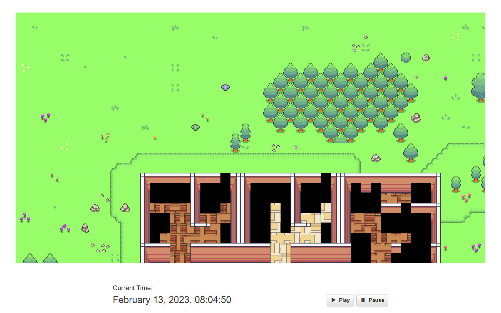

# 用 DeepSeek 复现 Generative Agents

这个仓库是 [joonspk-research/generative_agents](https://github.com/joonspk-research/generative_agents)
的复现分支，把原来依赖 OpenAI 的部分换成了 DeepSeek，并保留了论文里的核心机制：
感知 → 记忆检索 → 反思 → 计划 → 行动 → 对话。

分支：deepseek-port（自己的 fork：PAX233/generative_agents）。

## 1. Python 版本怎么定的

上游 README 写的是“在 Python 3.9.12 上测试过”，再对照 requirements.txt：

| 依赖 | 约束 | 结论 |
| --- | --- | --- |
| Django 2.2 | 官方支持 Python 3.5–3.9 | 最高 3.9 |
| numpy 1.25.2 | 要求 Python >= 3.9 | 最低 3.9 |
| Pillow 8.4.0 / pandas 2.0.3 | 老版本，3.9 有轮子 | 3.9 合适 |
| gensim 3.8.0 | 在 3.9 上很难编译，且模拟跑不到 | 不装 |

所以选 **Python 3.9**（用 uv 安装的是 3.9.22），依赖精简成
requirements-deepseek.txt，不再安装原 requirements.txt 里那一堆用不到、
又容易装不上的包。

## 2. 改了哪些东西，为什么

| 文件 | 改动 |
| --- | --- |
| persona/prompt_template/gpt_structure.py | 不再用 OpenAI SDK，改为调用 llm_client；纯文本补全类提示改成“续写”模式；JSON 输出解析容错（去掉围栏、前后废话） |
| persona/prompt_template/llm_client.py | 新增。DeepSeek 的 OpenAI 兼容 chat 接口封装：超时、重试、停止符、token 与费用统计（写 llm_usage.jsonl） |
| persona/prompt_template/embedding_client.py | 新增。DeepSeek 没有 embedding 接口，用本地 ONNX 模型 all-MiniLM-L6-v2（384 维）顶替 text-embedding-ada-002；模型缺失时自动退化为哈希向量，保证程序不崩 |
| persona/memory_structures/associative_memory.py | 加载老存档时发现向量维度不一致（1536 维 ada-002），自动用本地模型重算 |
| reverie.py | 新建模拟时补建 movement/ 目录（空目录不会被 git 保存）；支持 GA_START_TIME 指定起始时间；去掉没用到的 selenium 导入 |
| persona/prompt_template/run_gpt_prompt.py | 修复上游“任务分解”解析的 bug：模型多输出一行就会 IndexError 崩溃 |
| persona/memory_structures/scratch.py | 保存时 act_start_time 为空不再崩溃（上游假定一定非空） |
| scripts/virtual_frontend.py | 新增。没有浏览器时也能驱动模拟：替代前端页面做 environment/movement 文件交换 |
| scripts/download_embedding_model.py | 新增。下载本地 embedding 模型（约 90MB） |
| utils.example.py | 新增。配置样例；真正的 utils.py 在 .gitignore 里，只放本地密钥 |

## 3. 快速开始

~~~bash
git clone https://github.com/PAX233/generative_agents.git
cd generative_agents
git checkout deepseek-port

# 1) 环境
uv venv --python 3.9 .venv
uv pip install -r requirements-deepseek.txt

# 2) 本地 embedding 模型（约 90MB，只需要下一次）
python scripts/download_embedding_model.py
# 国内网络可加 --mirror

# 3) 配置密钥（二选一）
cp reverie/backend_server/utils.example.py reverie/backend_server/utils.py
# 编辑 utils.py 填入 deepseek_api_key
export DEEPSEEK_API_KEY=sk-...        # 或者用环境变量
~~~

运行（和原 README 一样，需要两个终端）：

~~~bash
# 终端 1：环境服务器
cd environment/frontend_server
../../.venv/Scripts/python.exe manage.py runserver 127.0.0.1:8000

# 终端 2：后端模拟
cd reverie/backend_server
../../.venv/Scripts/python.exe reverie.py
# fork 名称输入：base_the_ville_isabella_maria_klaus
# 新模拟名称输入：my-sim
# 然后输入：run 30
~~~

浏览器打开 <http://127.0.0.1:8000/simulator_home> 就能看到小人走动（原版流程）。

没有图形界面时，用无头驱动代替浏览器：

~~~bash
python scripts/virtual_frontend.py --sim-code my-sim --steps 30
~~~

想从白天开始（避免整夜空跑），可以在启动后端前设置：

~~~bash
export GA_START_TIME="February 13, 2023, 08:00:00"
~~~

## 4. 实测结果

- 3 个智能体（Isabella / Maria / Klaus），从 08:00 开始跑 **30 步**（10 秒/步，共 5 分钟游戏时间）
- 用时约 **90 秒**，**92 次** LLM 调用，输入 75.7k token、输出 2.85k token
- 估算费用 **约 0.13 元人民币**（按 deepseek-chat 官方价格）
- 模拟结束时时间推进到 `February 13, 2023, 08:05:00`，三个人的状态：
  - Isabella：已经在 Hobbs Cafe 柜台后面开店营业
  - Klaus：早上起床洗漱，准备去图书馆
  - Maria：还在睡觉（她的日程是 9 点起床）
- 记忆：Isabella 15 条（14 事件 + 1 思考）、Klaus 8 条、Maria 9 条；
  每条记忆都有 384 维向量，检索、反思、计划、行动整条链路都跑通
- 前端 replay 页面可以正常回放（下图是 `/replay/ds-demo-1/0/` 的截图）：

> 第一个模拟步骤最贵（要给三个人生成全天计划 + 每小时安排 + 任务分解），
> 之后的步骤主要是感知和移动，基本不花钱。

**第二次：加载历史记忆 + 午间场景**（`call -- load history the_ville/agent_history_init_n3.csv`，
从 11:50 开始跑 40 步）：

- 127 次调用、约 0.17 元、121 秒
- Maria 和 Klaus 在宿舍公共区真的聊了起来：聊 Klaus 的论文、Maria 的量子力学
  期中考试，还互相给建议；这段对话被写进两人的长期记忆（chat 类型节点），
  并参与之后的检索
- replay 页面时间推进到 `February 13, 2023, 11:55:50`，地图正常渲染

这两次运行说明“感知 → 记忆 → 检索 → 反思/计划 → 行动 → 对话”整条链路都能跑通，
而不只是把 API 换掉。

## 5. 费用怎么看

每次请求都会追加一行到 reverie/backend_server/llm_usage.jsonl，包含输入/输出
token、缓存命中、估算费用。最后一次 fin 时终端也会打印一行汇总。

价格在 utils.py 里可改（默认按 DeepSeek 官方人民币价格配置）。

第一步最贵，因为要给每个智能体生成全天的计划和每小时安排；之后大部分步只是
感知和移动，花费会小很多。

## 6. 密钥安全

- 密钥只放在 reverie/backend_server/utils.py 或环境变量里；
- utils.py、llm_usage.jsonl、models/、模拟输出目录都在 .gitignore 里；
- 提交前可以自己检查：git log -p | grep "sk-"（应该没有输出）。

## 7. 已知限制

- 本地 all-MiniLM-L6-v2 和 OpenAI ada-002 不是同一个模型，检索排序会有差异，
  但机制一致。
- 个别提示词原本是给补全模型（text-davinci）写的，DeepSeek 用“续写”指令能对齐
  大部分格式；如果长时间跑遇到新的格式问题，通常只需要在
  run_gpt_prompt.py 对应的 __func_clean_up 里加容错。
- 上游代码对 Python 3.9 + Django 2.2 的组合没问题，但需要按本仓库的
  requirements-deepseek.txt 安装，不要直接装原始 requirements.txt。

## 8. 参考

- 原项目：<https://github.com/joonspk-research/generative_agents>
- 论文：Park et al., Generative Agents: Interactive Simulacra of Human Behavior, UIST 2023